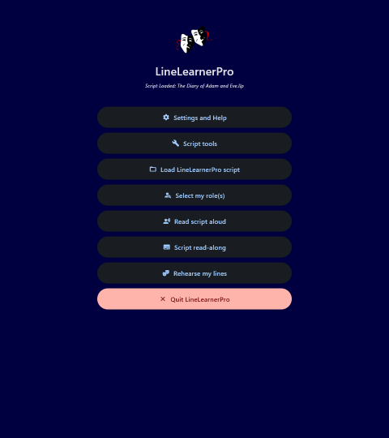
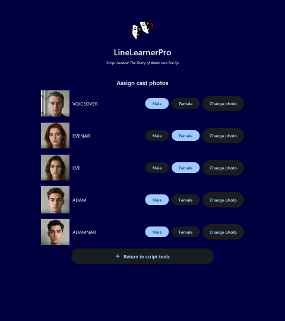
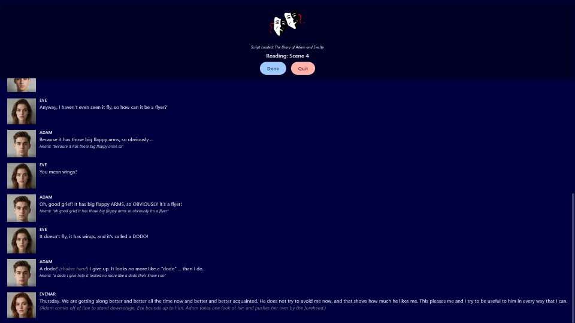

<p align="center">
  
</p>

<h1 align="center">LineLearnerPro</h1>

<p align="center">
  <strong>A unique rehearsal partner for performers learning their lines.</strong>
</p>

<p align="center">
  <a href="https://linelearnerpro.page.gd">Website</a> &middot;
  <a href="https://github.com/GeneraxGames/LineLearnerPro/releases/latest">Download</a> &middot;
  <a href="https://linelearnerpro.page.gd/screenshots.html">Screenshots</a> &middot;
  <a href="https://linelearnerpro.page.gd/faq.html">FAQ</a>
</p>

<p align="center">
  
  
</p>

LineLearnerPro reads your script aloud with a different voice for every character, then listens while you say your own lines. It is free, open source, and works entirely offline once its voices and hearing models have been downloaded: no account, no ads, no tracking.

<p align="center">
  
  &nbsp;
  
</p>
<p align="center">
  
</p>

## What it does

- **Cast your script.** Load a plain-text script and LineLearnerPro works out who is in it. Give each character a headshot and a voice (or leave them on the built-in default); choose which role or roles are yours.
- **Three ways to rehearse**
  - **Read script aloud**: the whole script performed back to you, every character in their own voice.
  - **Script read-along**: the script follows the audio, line by line, so you can learn the shape of a scene.
  - **Rehearse my lines**: the other characters are read to you, then the app listens while you say your own lines, shows you what it heard, and flags lines that look off. The flags are advisory only; the read-through always carries on.
- **Smart Cue.** Jumps ahead to roughly 30 seconds before your own next line, so you don't have to sit through a long stretch of someone else's dialogue to reach your cue. It never cuts a line off partway; if it would land mid-line, that line is read from its start. Available in all three modes.
- **Work scene by scene** or read the complete script. Scenes your role doesn't appear in are greyed out so you can focus on the ones that matter.
- **Pronunciation dictionary.** Teach it how to say the names and words it gets wrong; the fix applies every time.
- **Voice manager.** 43 free voices to browse, preview, download and delete: mostly US and British English, plus a handful in other languages.
- **Hearing quality.** Choose the speech-recognition model to suit your hardware: Low (about 40 MB), Medium (about 128 MB) or High (about 1.8 GB).
- **Share a prepared script.** Save your setup as a single `.llp` file (script, cast photos and voice assignments). Hand that one file to a castmate and they can start rehearsing without redoing the setup.
- Light and dark modes.

## Install

Download the latest build from the [Releases page](https://github.com/GeneraxGames/LineLearnerPro/releases/latest).

### Windows

Run `LineLearnerPro-Windows-Setup.exe`. It installs the required Visual C++ runtime for you if it is missing, and offers to put an example script and example headshots on your Desktop.

### Linux

1. Extract `LineLearnerPro-Linux.zip` somewhere permanent (your Home folder is fine). It runs from wherever you put it.
2. Install the system libraries it relies on (Debian, Ubuntu and Mint shown; other distributions have equivalents):

   ```bash
   sudo apt install libgtk-3-0 libportaudio2 zenity gstreamer1.0-plugins-good gstreamer1.0-plugins-bad gstreamer1.0-plugins-ugly gstreamer1.0-libav
   ```

3. Optional: add it to your application menu with `bash install.sh` (use `bash`, not `./`, as zip files don't always keep the executable permission). Otherwise just run `./linelearnerpro`.

### First run

LineLearnerPro needs the internet **once**, to download its voices and hearing model. Everything is stored in `~/.linelearnerpro` (on Windows, `C:\Users\<you>\.linelearnerpro`), and after that it runs offline.

## Quick start

1. **Script tools → Load txt script** and pick your script, or **Load LineLearnerPro script** to open a prepared `.llp` file.
2. **Analyse script** to discover the cast.
3. Optional: **Assign cast photos** and **Assign voices**.
4. **Save LineLearnerPro script.** Nothing survives closing the app unless it has been saved as a `.llp`.
5. Back on the main menu, **Select my role(s)**, then choose **Read script aloud**, **Script read-along** or **Rehearse my lines**.

For **Rehearse my lines**, pick and download a hearing model first under **Settings and Help → Hearing quality**. Low is the safe starting point on older hardware. The app's built-in Help covers all of this in more detail.

## Script format

Scripts are plain `.txt` files. Every block (header, stage direction or line of dialogue) is separated from the next by a blank line:

```text
[Act 1]

[Scene 1]

(The kitchen. Morning. EVE is reading; ADAM enters.)

EVE: Good morning!

ADAM: Is it? (He rubs his eyes.) I hadn't noticed.
```

| Block | How to write it |
| --- | --- |
| Header | A whole block wrapped in square brackets, e.g. `[Act 1]`, `[Scene 2]`, `[Introduction]`. A header starting with "Act" begins a new act; any other header begins a new scene. |
| Stage direction | A whole block wrapped in parentheses. |
| Dialogue | An **UPPERCASE** character name, a colon, then the line. It may contain inline `(stage directions)`. |

`[Act]` headers are optional (a one-act play can go straight to `[Scene]`), and an act with no `[Scene]` headers is treated as a single scene.

> **Don't forget the blank lines.** If two speeches run together with no blank line between them, the app won't complain: the second speech is silently absorbed into the first character's line, and that speaker may disappear from the cast. Anything that doesn't match any of the shapes above is kept but never shown or spoken.

## Privacy

LineLearnerPro collects nothing and has no account system. The only network access is the one-off download of voices (from the [Piper voices collection](https://huggingface.co/rhasspy/piper-voices) on Hugging Face) and hearing models (from the [Vosk project](https://alphacephei.com/vosk/models)), plus links that open in your normal browser. Your scripts, photos and voice choices never leave your computer.

## Troubleshooting

- **A voice won't load ("Protobuf parsing failed" or similar).** The voice's download was incomplete. From version 1.2.0 the app checks every download and repairs a damaged voice automatically. On older versions, delete that voice's two files (`.onnx` and `.onnx.json`) from the `voices` folder inside `~/.linelearnerpro` and let the app download it again.
- **Rehearse my lines misses words.** Speech recognition accuracy varies with hardware and microphone quality, and a strong accent of any kind makes it struggle more often; that is a limit of the underlying technology rather than a setting. A higher hearing-quality tier can help if your PC can cope with it. Hearing currently uses English (US) models.
- **Linux: the app crashes on launch** with a message like `Timed out waiting for OpenGL frame`. This has been seen on older machines with weak integrated graphics under Cinnamon. Turning off desktop effects (compositing) fixes it.
- **Linux: the file picker doesn't open.** Install `zenity`, which the file dialogs use.

## Building from source

Requires Python 3.12 or newer. The exact dependency versions are pinned in `pyproject.toml` (Flet is pinned to the 0.86 series, which this code was written for), so install from those pins rather than taking the latest of everything. The project is a Flet app rather than an installable package, so `pip install .` won't work. Instead, in a virtual environment, generate a requirements list from `pyproject.toml` and install that:

```bash
python -m venv .venv
source .venv/bin/activate          # Windows: .venv\Scripts\activate
python -c "import tomllib; print('\n'.join(tomllib.load(open('pyproject.toml','rb'))['project']['dependencies']))" > requirements.txt
pip install -r requirements.txt
python main.py
```

To build a standalone app you also need Flet's command-line tools, at the same version as the pinned `flet` (`pip install flet-cli==<that version>`), and then:

```bash
flet build windows        # or: flet build linux
```

Flet's own documentation lists the toolchain each platform needs for `flet build`.

## Other platforms

macOS, iOS and Android builds are not available, and the reasons are technical rather than a matter of will:

- **macOS:** ONNX Runtime, which Piper depends on, no longer publishes Intel Mac builds, and the author has no modern Mac to build and test on. Apple Silicon is untested.
- **Android:** Vosk has no installable package for Python apps on Android, so it would need significant rework.
- **iOS:** not attempted.

You are welcome to fork the project and build your own variants, including ports to other platforms, as long as derivative works stay under the same licence. Bug reports are welcome via [Issues](https://github.com/GeneraxGames/LineLearnerPro/issues).

## Support the project

LineLearnerPro is free and always will be. If it has earned its keep in your rehearsals, please consider [buying the author a beer](https://paypal.me/linelearnerpro/5GBP).

## Credits

LineLearnerPro is written by Andrew "PJ" Canham of [Generax Games](https://generaxgames.gamer.gd), and built on some excellent open-source projects: [Piper](https://github.com/OHF-voice/piper1-gpl) (text-to-speech), [Vosk](https://alphacephei.com/vosk/) (speech recognition), [ONNX Runtime](https://onnxruntime.ai/) and [Flet](https://flet.dev/) (the user interface, built on Flutter).

Each voice comes from the Piper voices collection and has its own licence terms; see the voice's model card there.

## Licence

Released under the GNU General Public Licence v3.0. See [LICENSE](LICENSE).
